# 续章 · Novel Room

> 本地运行、可恢复的多 Agent 长篇小说续写编排器：模型只负责写，调度、记忆、门禁和交付全部由本机状态机说了算。

一个单用户、本机部署的「小说续写编辑部」。后端状态机负责素材拆分、九维总结、章纲审批、分章写作、并行审校、最多三轮定向返工、主 A 仲裁与最终交付；模型只接收明确的任务信封并返回文本或结构化 JSON，不拥有文件，也不掌握调度权。内置确定性假 Provider，**不配置任何 API key 也能跑通整条流水线**；接入 OpenAI / DeepSeek 时，密钥只留在后端进程，预算在章纲批准时一次性冻结。

下文界面截图均来自本机真实运行的演示模式（`NOVEL_TEST_FAKE_PROVIDER=1`，样例素材为自撰短篇《青灯剑影》），未使用任何占位图或效果图；假 Provider 产出的正文为确定性模板文本，正式效果以真实模型为准。

## 界面速览

<table>
<tr>
<td width="50%" align="center">
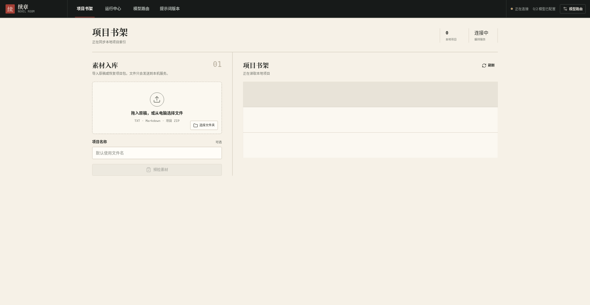<br>
<strong>项目书架</strong><br>
导入 TXT / Markdown / 项目 ZIP，本机项目与素材一屏管理
</td>
<td width="50%" align="center">
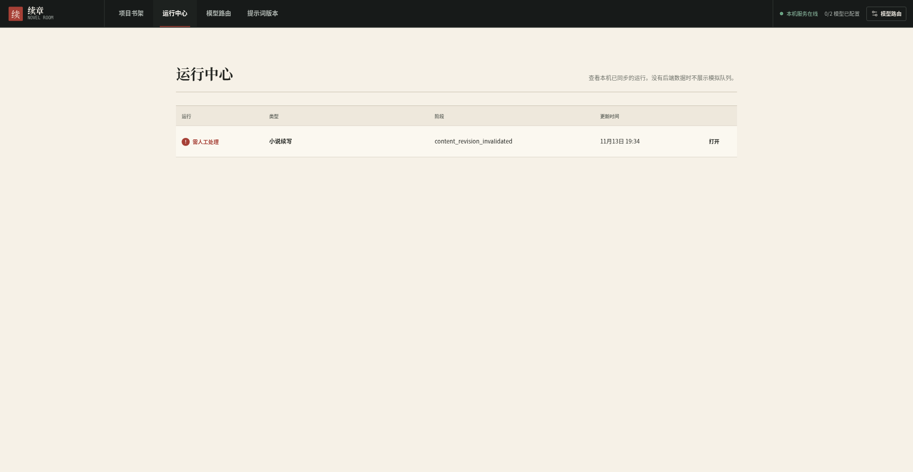<br>
<strong>运行中心</strong><br>
同步当前运行的类型、阶段与状态，不展示任何模拟队列
</td>
</tr>
<tr>
<td align="center">
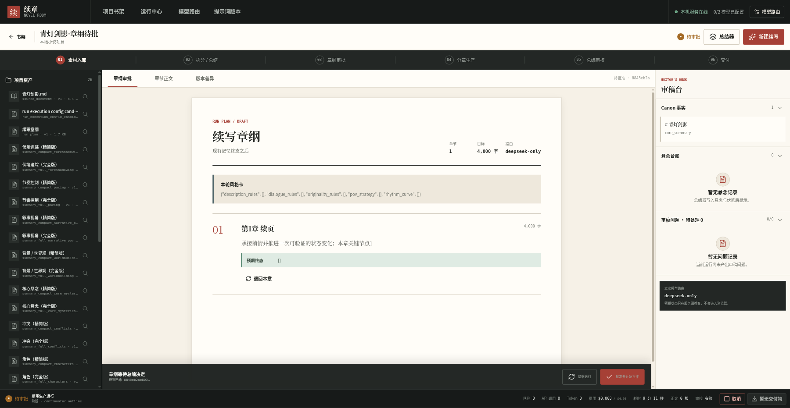<br>
<strong>章纲审批 · 人工门禁</strong><br>
章纲哈希待批，可退回本章 / 整纲退回；批准前不会派发一个正文写作调用
</td>
<td align="center">
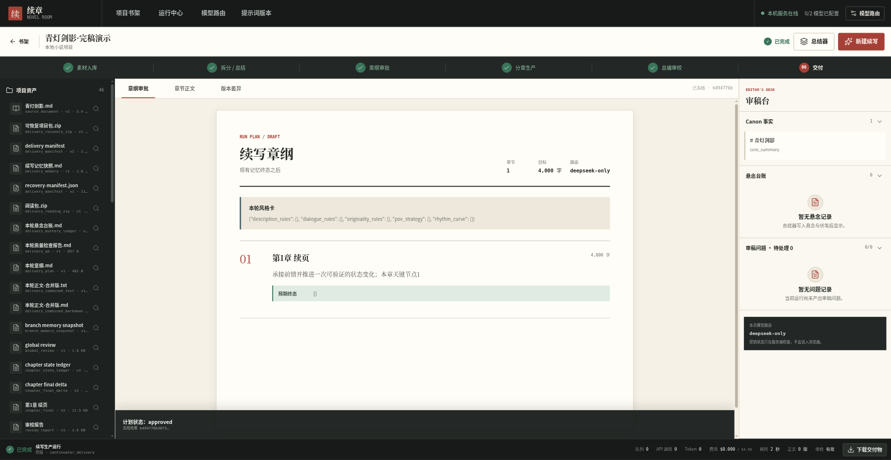<br>
<strong>工作台 · 六段流程轨</strong><br>
素材入库 → 拆分总结 → 章纲审批 → 分章生产 → 总编审校 → 交付，左产物、中稿纸、右审稿台
</td>
</tr>
<tr>
<td align="center">
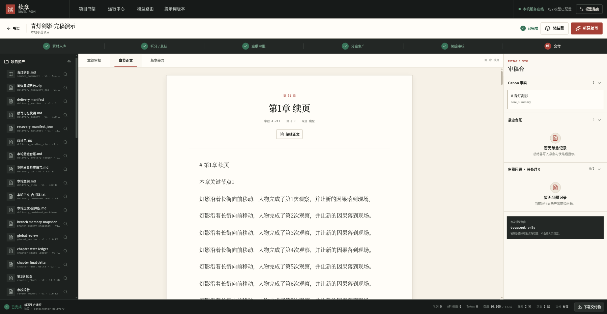<br>
<strong>章节正文</strong><br>
纸感阅读与人工编辑，显示字数、修订版本与内容来源
</td>
<td align="center">
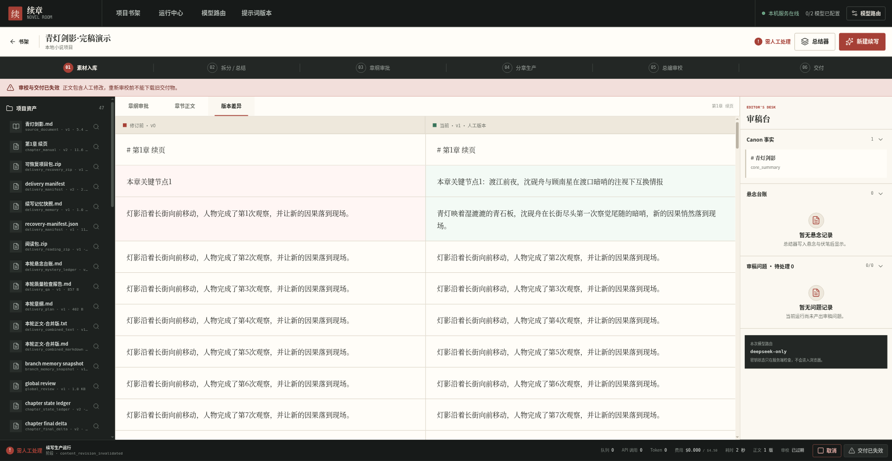<br>
<strong>版本差异</strong><br>
人工修订生成不可变新版本，双栏对照增删；改后审校与交付立即失效并强制复审
</td>
</tr>
<tr>
<td align="center">
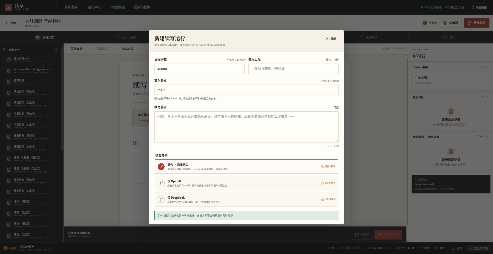<br>
<strong>新建续写运行</strong><br>
4,000–150,000 字目标、费用 / Token / 调用 / 时长预算与三种路由预设一次锁定
</td>
<td align="center">
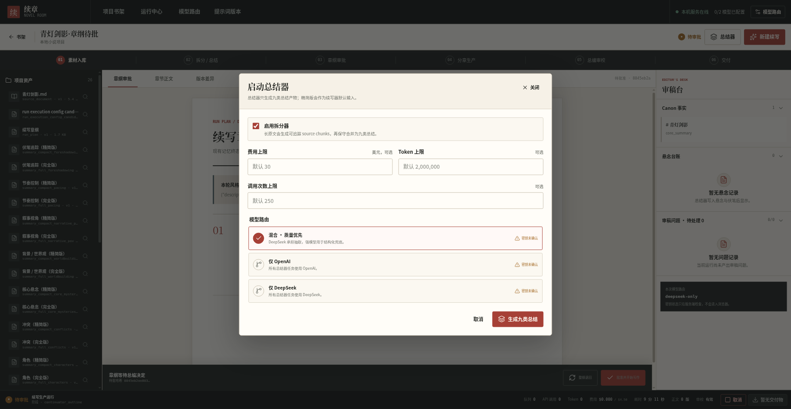<br>
<strong>总结器</strong><br>
拆分器开关与预算项，一键生成九类故事状态（精简版 / 完全版各一份）
</td>
</tr>
<tr>
<td align="center">
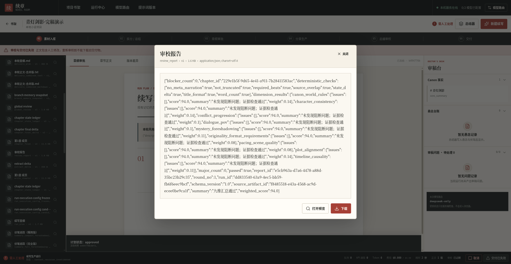<br>
<strong>产物预览 · 九维审校</strong><br>
每个产物按内容哈希寻址，可直接预览或下载，审校分数与证据全程留痕
</td>
<td align="center">
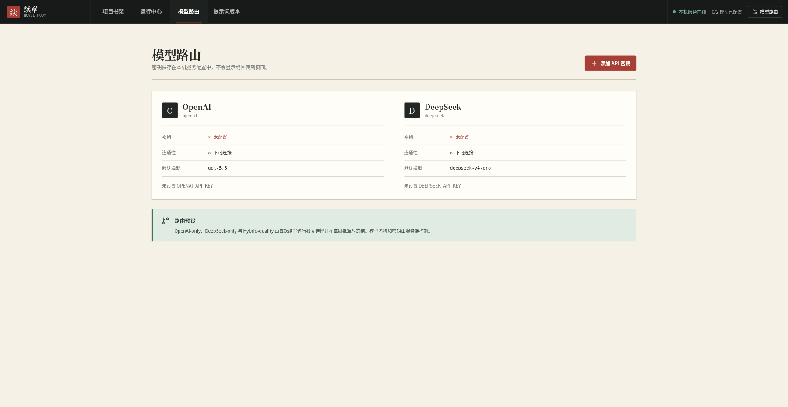<br>
<strong>模型路由</strong><br>
密钥只在服务端配置，页面只显示配置状态，永不回传已保存的密钥
</td>
</tr>
<tr>
<td align="center">
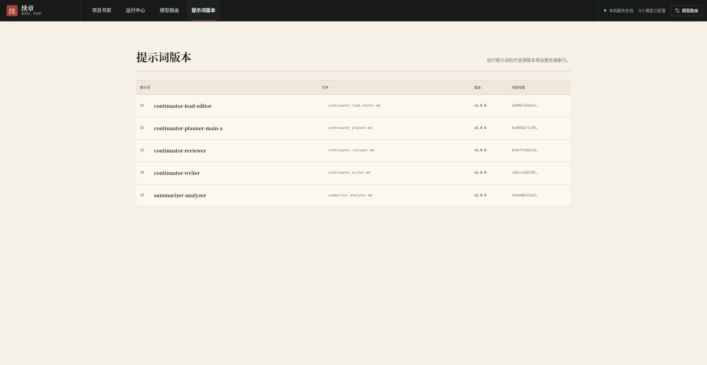<br>
<strong>提示词版本</strong><br>
运行提示词文件化、版本化，内容哈希可追溯
</td>
<td></td>
</tr>
</table>

## 1. 快速启动

环境要求：Python 3.12+、Node.js 20.19+ 或 22.12+（Vite 7 要求）；推荐使用 [uv](https://docs.astral.sh/uv/) 管理后端依赖。演示模式不需要任何 API key。

### 1.1 Windows（推荐路径，PowerShell 7）

```powershell
# 1) 安装后端与前端依赖（脚本会拒绝 Python 3.12 以下解释器）
pwsh.exe -File .\scripts\bootstrap.ps1
Copy-Item .env.example .env

# 2) 安全演示：强制内置确定性假 Provider，不发出任何计费请求
pwsh.exe -File .\scripts\start.ps1 -Demo

# 也可显式隔离一份演示数据目录
pwsh.exe -File .\scripts\start.ps1 -Demo -DataDir .\data-demo-qa
```

`start.ps1` 会依次执行 `alembic upgrade head`、`npm run build`，最后由 FastAPI 在同一地址托管 `frontend/dist` 与 `/api`。浏览器打开 <http://127.0.0.1:8000>。已有最新构建时可加 `-SkipBuild`。

### 1.2 Linux / macOS（等价手动命令）

```bash
# 1) 后端依赖
uv sync

# 2) 前端依赖与生产构建
npm --prefix frontend install
npm --prefix frontend run build

# 3) 数据库迁移（演示数据独立隔离到 data/demo）
NOVEL_DATA_DIR=./data/demo .venv/bin/python -m alembic upgrade head

# 4) 以演示模式启动（假 Provider，零计费）
NOVEL_TEST_FAKE_PROVIDER=1 \
NOVEL_DATA_DIR=./data/demo \
NOVEL_HOST=127.0.0.1 NOVEL_PORT=8000 \
.venv/bin/python -m uvicorn backend.app.main:app --host 127.0.0.1 --port 8000
```

### 1.3 开发模式（前端热更新）

```powershell
# Windows
pwsh.exe -File .\scripts\dev.ps1 -Demo
```

```bash
# Linux / macOS：两个进程分别启动
NOVEL_TEST_FAKE_PROVIDER=1 NOVEL_DATA_DIR=./data/demo \
  .venv/bin/python -m uvicorn backend.app.main:app --port 8000 --reload
npm --prefix frontend run dev          # http://127.0.0.1:5173，/api 自动代理到 8000
```

### 1.4 接入真实 Provider（显式开启）

密钥只放在根目录 `.env` 或启动后端的进程环境中，不会进入浏览器、SQLite、日志或导出包；切勿创建 `VITE_OPENAI_API_KEY` 等前端变量。

```powershell
$env:OPENAI_API_KEY = "..."       # 或写入 .env；两个 key 至少配一个
$env:DEEPSEEK_API_KEY = "..."
pwsh.exe -File .\scripts\start.ps1 -AllowRealApi -DataDir .\data-live
```

`-AllowRealApi` 是启动层的计费授权：没有任何服务端 key 时脚本拒绝启动。它不替代每轮预算——新建续写时填写费用上限，批准章纲时同时冻结 `max_cost`、`max_tokens`、`max_calls`、`max_wall_time`；预算达 80% 告警、达 100% 停止派发新调用。支持 `openai-only`、`deepseek-only`、`hybrid-quality` 三种路由预设，默认模型名可用 `NOVEL_OPENAI_MODEL` / `NOVEL_DEEPSEEK_MODEL` 覆盖，兼容协议的中转服务用 `NOVEL_OPENAI_BASE_URL` / `NOVEL_DEEPSEEK_BASE_URL` 配置（保留服务要求的 `/v1` 前缀）。

## 2. 六阶段编排如何落地

| 阶段 | 后端实现 | 可演示入口 |
| --- | --- | --- |
| ① 素材入库 | 自动识别 UTF-8 / UTF-16 / GB18030 编码，边界感知拆章，支持多文件合并与项目 ZIP 恢复 | 书架「拖入原稿 / 选择文件」、预检素材 |
| ② 拆分 / 总结 | 总结器先生成可溯源 source chunks，再保守合并为九类 Canon 故事状态（角色、冲突、悬念、视角、世界观、节奏等，各有精简 / 完全两版） | 工作台「总结器」、左侧九维产物 |
| ③ 章纲审批 | 规划 Agent 产出 `run_plan` 与执行配置候选，计算计划哈希；人工批准后冻结，支持退回本章与整纲退回 | 「章纲审批」页、底部批准 / 退回按钮 |
| ④ 分章生产 | 写作 Agent 按冻结章纲逐章产出；相邻章节默认串行，仅当章纲声明独立状态域才可并行；调用前冻结全部预算 | 流程轨「分章生产」、底部队列 / Token / 费用状态条 |
| ⑤ 总编审校 | 五组并行九维审校 → 主 B 汇总排序 → 最多三轮定向返工 → 主 A 仲裁；通过后还要全轮复审 | 右侧审稿台、审校报告产物、问题定位与版本差异 |
| ⑥ 交付 | 质量门禁全过才构建交付物：合并正文 TXT/Markdown、QA 报告、记忆快照、悬念台账、阅读包 ZIP、可恢复项目包 ZIP 与 manifest | 底部「下载交付物」、项目资产列表 |

核心不变量（详见 [docs/ARCHITECTURE.md](docs/ARCHITECTURE.md)）：模型永远拿不到文件系统权限；草稿不是状态，只有通过校验的产物才能解锁下游任务；运行内记忆必须在终审与 compare-and-swap 检查通过后才提升为分支头；JSON 是正式事实来源，Markdown/TXT 只是可重建视图。

## 3. 九维审校与质量门禁

每章正文由五个并行审校组独立打分，主 B 汇总为九个维度并按固定权重加权：

| 维度 | 权重 | 维度 | 权重 |
| --- | --- | --- | --- |
| 情节对齐 `plot_alignment` | 0.14 | 角色一致 `character_consistency` | 0.14 |
| Canon / 世界观规则 `canon_world_rules` | 0.14 | 时间线因果 `timeline_causality` | 0.11 |
| 悬念伏笔 `mystery_foreshadowing` | 0.11 | 冲突推进 `conflict_progression` | 0.10 |
| 对话与叙事视角 `dialogue_pov` | 0.10 | 节奏与场景质量 `pacing_scene_quality` | 0.08 |
| 原创性与格式要求 `originality_format_requirements` | 0.08 | | |

每条问题携带稳定 issue_id、位置、规则、证据与修订指令；阻断项未清零不得进入交付。定向返工最多三轮，超限后主 A 可仲裁放行或升级为 `needs_human`；人工修改正文会使审校与交付立即失效，重新审校前无法下载旧交付物。

## 4. 安全模型与预算

- **密钥不出后端**：密钥仅存在于 `.env` 或服务端进程环境，API 只回传「是否已配置」，前端仓库不出现任何 key 字段。
- **预算先冻结后调用**：费用、Token、调用次数、墙钟时长在章纲批准时全部锁定；80% 告警、100% 停止派发。
- **暂停 / 取消语义明确**：暂停只阻止新调用，允许在途结果隔离落盘；取消保留部分产物但不提升分支记忆。
- **不假设恰好一次**：调用已发出、结果持久化前进程退出时，任务标记为 `indeterminate`，重试前必须人工确认可能重复计费；恢复阶段在工作台「任务恢复面板」显式处理。
- **提示词隔离**：原稿全文一律作为不可信数据加边界封装，稿件中的文字无法篡改工具或调度行为。

## 5. 数据、产物与迁移

- 默认数据目录为 `data/`，可用 `NOVEL_DATA_DIR` 整体隔离（演示模式默认隔离到 `data/demo/`）；设置该变量时保持 `NOVEL_DATABASE_URL` 未设置，让 SQLite 随数据目录一起搬迁。
- SQLite 只存索引与运行状态；大型产物写入内容寻址的本地 artifact 目录，哈希即文件名，不可变、可复算。
- 服务首次启动会创建缺失表；**已有数据的结构升级必须走 Alembic**：

```bash
.venv/bin/python -m alembic upgrade head
```

- 可恢复项目包包含完整 manifest 与全部交付产物，换机后通过书架导入即可续写；阅读包只含阅读所需文件，不含运行内部状态。

## 6. 测试

```powershell
# Windows：后端 pytest + 前端 Vitest 一把跑完
pwsh.exe -File .\scripts\test.ps1
```

```bash
# Linux / macOS
.venv/bin/python -m pytest -q          # 后端 83 个用例，全部使用 mock / 假 Provider，不读取 key、不计费
npm --prefix frontend test            # 前端 11 个测试文件、25 个 Vitest 用例
npm --prefix frontend run build       # tsc -b 类型检查 + Vite 生产构建
```

后端用例覆盖编解码拆章、语料完整性、核心契约、质量门禁、Provider 适配、状态机运行、冻结与恢复阶段、全局审计、人工修订乐观锁、导出构建等；前端覆盖工作台、章纲、差异、对话框、状态标记等组件交互。仓库内没有会自动计费的 live-test 命令，真实 Provider 验证只能通过 `-AllowRealApi` 手动开启，并受当轮预算约束。

## 7. 文档与目录

```text
backend/app/            API、状态机、Provider 适配、契约、质量门禁与导出
backend/prompts/        精炼且版本化的运行提示词（analyzer / planner / writer / reviewer / lead_editor）
backend/migrations/     Alembic 数据库迁移
backend/tests/          pytest 自动化测试（全部 mock / 假 Provider）
frontend/src/           React 编辑部工作台（书架、工作台、运行中心、模型路由、提示词版本）
scripts/                bootstrap / start / dev / test 等 Windows 引导脚本
docs/ARCHITECTURE.md    多 Agent 架构不变量
docs/DESIGN.md          编辑部界面设计规格
docs/shots/             本 README 使用的全部真实界面截图
docs/reference-prompts/ 原始 Skill 与续写 / 总结提示词的只读参考副本
data/                   运行时数据（SQLite、artifact、项目与交付），不入库
```

## 8. 已知边界

1. 当前是本机源码分发的单用户应用，不生成 EXE 或容器镜像，也没有多用户权限体系；FastAPI 直接托管前端构建产物。
2. 演示模式的假 Provider 只输出确定性模板文本与结构化桩结果，用于验证编排、门禁与可恢复性，不代表真实文风；正式写作质量需接入 OpenAI / DeepSeek 后评估。
3. 浏览器端为桌面优先的三栏布局；窄屏下右栏转为抽屉，手机端只支持监看、审批、控制运行与下载，正文编辑与版本差异请在桌面端操作。
4. 当前主干有 1 个既有用例失败：`test_three_revision_rounds_then_arbitration_and_full_recheck_needs_human` 内的脚本化 Provider 桩未实现生产流程已引入的 `global_review` 操作，会触发桩自身的 `unexpected operation` 断言；内置假 Provider 的实际演示流水线与其余 82 个后端用例、25 个前端用例均正常。
5. 样例素材《青灯剑影》与 `data/demo/` 下的演示数据仅用于截图与试用，不是正式素材，请勿将演示目录当作正式项目目录使用。
